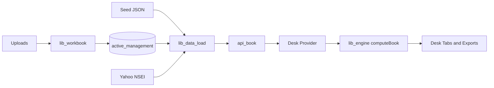

# Architecture

Last updated 06-Nov-2026 IST.

## Stack

- Next.js 15.5 App Router, React 19, TypeScript strict, Node 24.
- Tailwind 3 with the Unwinding Calculator tokens: maroon `#7a1e2c` and `#5c1520`, gold `#d4b24c`, `#e5cf94` and `#b8860b`, `darkMode: "class"`, Times New Roman body and Segoe UI for controls. `app/globals.css` is copied from Unwinding; the only addition is a dark background for inputs.
- framer-motion, lucide-react, clsx with tailwind-merge, zod, `@tanstack/react-virtual` for the book, leg and scenario tables.
- exceljs and jsPDF with autotable for exports, built in the browser.
- MongoDB driver with a JSON seed fallback; date-fns for month labels.
- Vitest for the engine; one Chromium Playwright smoke on manual dispatch.

## Layout

```
app/                 routes and API
components/layout/   shell, header, tab rail, footer, Workstation embed listener
components/ui/       panels, KPI band, tab heading, virtualized desk table
components/desk/     inputs bar, Expected Difference cell, loading gate
components/pages/    one file per tab
lib/engine/          pure engine: black-scholes (Unwinding copy), vol-surface, rates, fixings,
                     observations, leg-pricing, product-unwind, expected-difference, book
lib/data/            Mongo plus seed loader, baked seed JSON
lib/workbook/        upload parsers: product master, surface, NSE chain, fixings
lib/export/          Excel and PDF
lib/navigation.ts    tabs, also the Workstation allowlist
scripts/             bake-seed.py (developer fixture bake), verify-active-management.ts
tests/               Vitest suites and workbook golden fixtures
e2e/                 Chromium smoke
```

## Data Flow



`GET /api/book` returns the active book, surface, chains, spreads and fixings, with the as-of inputs: valuation date today in Asia/Kolkata and the last completed Nifty close from Yahoo (the seed's own as-of when Yahoo is unreachable). The browser holds the inputs in `lib/context/desk-provider.tsx` and recomputes the whole book with `computeBook` whenever an input changes. Each unique Strike, Expiry, Option and Side is priced once and reused by every leg.

`POST /api/book/compute` runs the same engine on the server for API consumers.

## SP Workstation Embed

SP Workstation frames the desk and posts `{ type: "active-management:navigate", path }` to change tab without reloading the frame. `lib/embed-navigation.ts` accepts the message only when:

- it comes from `window.parent`,
- its origin is `https://sp-workstation.vercel.app`, or `http://localhost:3000` and `http://127.0.0.1:3000` outside production,
- the path is one of the tabs in `lib/navigation.ts`.

`components/layout/embed-navigation.tsx` then calls `router.replace(path)`, so the desk inputs survive the tab change.
